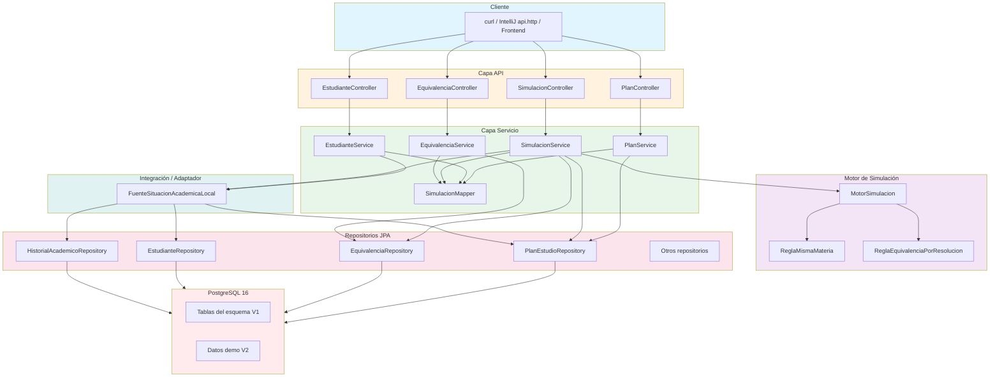
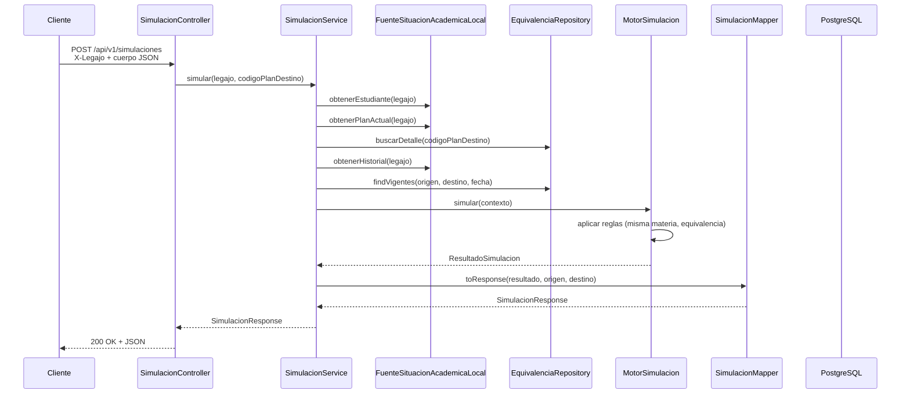

# Arquitectura del Simulador de Migración

## Diagrama de capas

## Flujo de una simulación

## Separación de responsabilidades

| Capa | Responsabilidad | No hace |
|---|---|---|
| **API** | Recibir HTTP, validar entrada, devolver JSON | Lógica de negocio, consultas SQL |
| **Servicio** | Casos de uso, transacciones, orquestación | Parsing HTTP, mapeo a JSON |
| **Motor** | Reglas de reconocimiento, algoritmo de simulación | Acceso a base de datos, HTTP |
| **Integración** | Adaptar la fuente académica (JPA local) | Lógica de negocio |
| **Repositorio** | Consultas a PostgreSQL | Lógica de negocio, transacciones |
| **DTO** | Contrato de salida/entrada | Lógica |

## Tecnologías

- **Java 21** — Lenguaje.
- **Spring Boot 4.1.2** — Framework principal.
- **Spring Web MVC** — Capa API REST.
- **Spring Data JPA / Hibernate** — Persistencia.
- **Flyway** — Migraciones de esquema y datos demo.
- **Spring Security** — Configuración (hoy permisiva, sin JWT).
- **Spring Boot Actuator** — Health check.
- **Lombok** — Reducción de boilerplate.
- **Maven Wrapper** — Build sin Maven instalado.
- **Testcontainers** — Tests de API con PostgreSQL efímero.
- **Docker / Docker Compose** — Despliegue todo en contenedores.
